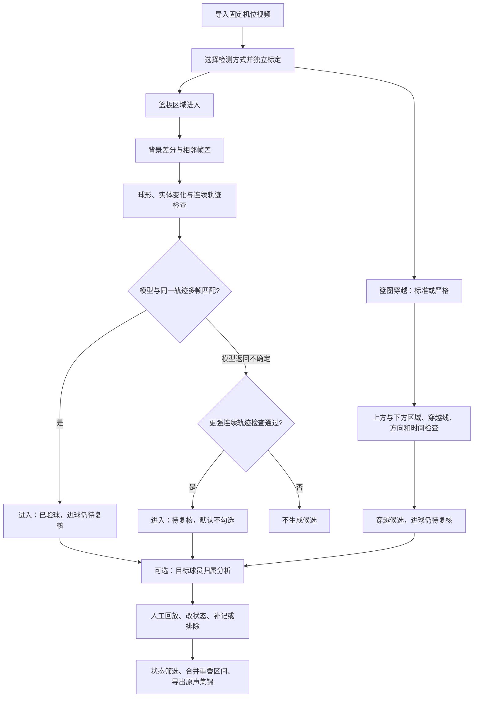
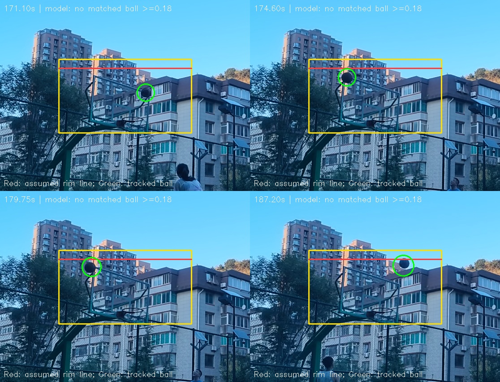

# 篮球剪辑大师：分析原理与已知限制

[返回首页](../README.md) · [图文使用指南](usage-guide.md) · [完整功能说明](../basketball_master/README.md)

本文依据当前仓库实现编写，文档更新于 2026-10-18。软件采用 **局部运动检测 + 连续轨迹 + 球体模型复核 + 人工确认** 的工作方式。它把长视频缩小为值得回看的候选片段，不能代替裁判，也不承诺无遗漏地识别全部得分。

## 1. 总体流程



模型文件缺失、加载失败或推理报错会显示错误，**不会**被当作“模型不确定”来放行轨迹候选。

实现入口：[detection.py](../basketball_master/detection.py)、[region.py](../basketball_master/region.py)、[ball_verifier.py](../basketball_master/ball_verifier.py)。

## 2. 为什么篮板区域与篮圈要分开

| 分支 | 要回答的问题 | 框选要求 | 不能由此得出的结论 |
| --- | --- | --- | --- |
| 篮板区域进入（宽松） | 疑似篮球是否接触或进入指定区域？ | 框篮板与篮筐附近需要监测的区域 | 不证明穿过篮圈，更不证明得分 |
| 篮圈穿越（标准 / 严格） | 轨迹是否按顺序通过篮圈上、下区域及假定穿越线？ | 紧贴篮圈及篮网，不能框整块篮板 | 二维穿越仍不能完全排除偏前、偏后或遮挡误判 |

两类框分别保存为 `kind=region` 和 `kind=rim`；标准与严格共享篮圈框。旧项目没有 `kind` 的框只当作篮板区域，不根据旧模式猜测它是篮圈。没有相应标定时，界面和分析入口都会阻止运行。见 [project.py](../basketball_master/project.py) 的 `active_hoops`。

下图来自 167.8 秒后片段的历史排查：黄色是当时使用的区域框，绿色圈出跟踪到的球；**红线是旧诊断中把整块篮板框误用为篮圈后推算出的穿越线，不是真实篮圈，也不是现在推荐的画法。** 它说明为什么球已经进了区域，旧穿越规则却仍可能不满足。



图中 `no matched ball >=0.18` 指当次诊断未获得符合位置、尺寸和置信度条件的模型匹配，不能据此断言画面里没有球。截图是历史诊断材料，不是新算法准确率评测。

## 3. 篮板区域进入：如何找出运动的球

### 3.1 局部取帧与背景建模

程序只处理选区及周围适量留白，保留球入框前后的运动信息。分析默认按 20 fps 取帧，必要时提前读取最多 1.5 秒建立背景；区域检测器开始约 0.5 秒后才判断运动。

OpenCV 的 MOG2 建立固定摄像头的背景模型。同时计算：

- **背景差分**：当前画面相对背景发生了什么变化。
- **相邻帧差**：当前帧相对上一帧是否真的在动。
- **共同亮度补偿**：扣除裁剪画面的中位亮度变化，减少整幅曝光变化触发。

因此，不是“框里有像素变化就算进球”，也不是只按篮球的橙色筛选。快速球、暗色球和阴影下的球也需要由运动与形状提供证据。

### 3.2 轮廓与实体变化

对运动轮廓检查面积、长宽比、半径和圆形填充程度，排除过大、过细或明显破碎的轮廓。再检查轮廓中心是否像一个实体遮住了原背景，而不是大量明暗相抵的小碎纹理。

相邻帧还必须有足够的真实变化，以免把背景模型残留的旧位置当作新球。球边缘接触区域也可以算进入，不要求球心已完全越过边界。

### 3.3 连续轨迹

使用前两次位置估计速度，预测下一帧落点，再按位置与半径稳定性匹配。一帧中的一个点最多只属于一条轨迹，避免把同帧多个树叶碎块串成“多帧篮球”。

普通轨迹提案至少需要 3 个不同时间点、有效位移、尺寸稳定和近期实体证据。程序比较 **净位移 / 累计路程**：原地来回晃动时净位移小，即使总运动量大，也不容易通过。

### 3.4 球体模型复核

本地 `YOLO11s` 识别的是通用 `sports ball` 类别，不是专门针对本球场训练的篮球模型。

- 从最近最多 6 个不同时间点的原始彩色裁剪画面进行识别。
- 检测置信度门槛是 `0.18`，并检查模型框的尺寸与长宽比。
- 模型球的位置必须接近**正在复核的同一条运动轨迹**，附近另一颗球不能替一条树叶轨迹通过。
- 至少 2 个不同时间点匹配，才标记为 `ball-track-v1`，界面显示“进入（已验球）”。

`ball_score` 是匹配帧中较强的两次模型置信度的平均值，**不是进球概率**。“已验球”只表示模型支持球体身份，进球状态仍是“待复核”。

### 3.5 模型不确定时保留什么

小球、运动模糊、低对比度或部分遮挡时，模型可能不匹配。此时不直接丢弃，也不是降低门槛放行所有运动，而是追加更强的轨迹检查：

| 检查 | 当前实现的条件 |
| --- | --- |
| 连续性 | 最近 0.5 秒内至少 6 个观测点，跨度至少 0.2 秒，相邻间隔不大于 0.11 秒 |
| 尺寸稳定 | 最大与最小半径比例不大于 1.55 |
| 轮廓形状 | 圆形填充质量的中位数至少 0.60；较长轨迹可接受前段较弱、末段恢复球形 |
| 实体变化 | 至少 70% 的轨迹点有实体变化证据 |
| 有效位移 | 至少达到 20 像素、6 倍中位半径、选区短边的 25% 三者中的最大值 |
| 运动效率 | 净位移 / 累计路程至少 0.85 |
| 轨迹平滑 | 对横纵位置随时间做二次拟合，最大残差不大于 3 像素或 0.55 倍中位半径中的较大值 |

通过后记为 `trajectory-review-v1`，显示“进入（待复核）”，**默认不勾选导出**，进球状态仍为待复核，当前规则的证据分为 65。这些阈值是代码中的启发式规则，不是经过统计校准的成功率，也不是界面上可直接调节的设置项。

具体规则见 [RegionTracker.strong_trajectory](../basketball_master/region.py)。

## 4. 如何降低树叶、反光干扰

不是单靠一个模型或一个圆形判据，而是让多个条件共同起作用：

| 干扰 | 对应的抑制措施 |
| --- | --- |
| 全画面曝光变亮或变暗 | 扣除共同亮度变化，再看局部实体和相邻帧运动 |
| 篮网、反光或细碎纹理晃动 | 检查中心实体变化、明暗一致性、尺寸和圆形填充 |
| 树叶在原地来回摇晃 | 检查净位移、运动效率、半径稳定与平滑轨迹 |
| 多片树叶偶然拼出圆形 | 一对一跨帧匹配，不能用同帧多个碎块伪造轨迹 |
| 球和树叶同时出现 | 模型必须与同一轨迹的位置、尺寸和多个时间点匹配 |
| 模型偶尔漏认真实球 | 只保留通过更强轨迹规则的候选，标为待复核且不自动勾选 |

**仍可能误检，也可能把真实球过滤掉。** 反光如果恰好稳定移动成球形，或真实球被遮挡、过小、轨迹太短，都可能突破或无法通过这些规则。固定机位是前提；镜头移动会破坏背景假设。首先合理框选，再用短片试跑验证。

以上完整“连续轨迹 + 球体复核 + 强轨迹回退”链路用于**区域进入分支**，不能把它描述成标准/严格穿越分支已经具备的同一套验证。

## 5. 篮圈穿越如何判断

标准/严格分支使用独立篮圈框，依据运动轮廓建立轨迹；颜色仅提供辅助质量分，不是必须为橙色。

向下穿越要求轨迹从篮圈上方区域到下方区域，在规定时间内穿过框内的假定篮圈线；对横向位置、相邻时间间隔和明显反向跳动也有限制。当前穿越线取紧框顶部向下约 `0.12 × 框高`，所以标定位置非常重要。

严格模式进一步要求至少 4 个轨迹点、证据分至少 80。它提高规则要求，不代表必然比标准模式更适合所有视频，遮挡时可能增加漏检。两种穿越模式目前使用几何轨迹规则，不调用区域分支的 `BallVerifier`。

设置中可启用从下向上穿越；这只是反向运动候选，**不按篮球规则自动认定得分**，默认不勾选导出。向下候选默认勾选，但所有自动穿越候选都仍是待复核。见 [HoopTracker](../basketball_master/detection.py)。

## 6. 多球、重复检测与重扫

- 区域进入按轨迹去重，不再用整个区域的统一冷却时间屏蔽紧跟着的另一颗球。
- 对时间、位置、尺寸相近的短暂断轨及碰板反弹片段做连续性匹配，降低一次入框重复记录。
- 很接近的双球仍可能混淆；当前实现不能保证任意多球场景全部分离。
- 桌面重扫仅在方向、标定与多帧轨迹有足够匹配依据时更新旧记录的检测证据。人工进球状态、球员归属、导出勾选和手动片段边界保留。
- 旧事件缺少方向或轨迹、或匹配有歧义时保留独立记录；不同模式也可能为同一次出手生成多条候选。导出时合并重叠时间段，不等于删除候选记录。

实现：[region.py](../basketball_master/region.py)、[event_identity.py](../basketball_master/event_identity.py)、[app.py](../basketball_master/app.py)。篮圈穿越分支仍保留按方向划分的 2.2 秒冷却，不要与区域分支混淆。

## 7. 指定球员如何关联

程序不是“看见蓝衣服就算这个人进球”。对于候选时刻附近的短窗口，使用 YOLO 检测人与球，用 ByteTrack 跟踪球员，再结合出手前球与手部/上半身位置、球后续朝篮筐移动的趋势寻找可能的出手人。

球员样本分上衣、短裤、腿部比较颜色分布和明暗比例，权重分别约为 45%、35%、20%；同时比较不同球员的相似度差异。得到疑似目标、其他球员或待确定等结果，人工再确认。

没有球衣号码 OCR，也没有人脸识别；同款球衣、光照变化、遮挡、人物太小和入框事件并非真实投篮时，归属都可能出错。人工指定的球员归属受保护。见 [PlayerAnalyzer](../basketball_master/detection.py)。

## 8. 预览与导出是分开的

实时区域预览用单独后台工作线程，忙时跳过新预览采样，避免积压和卡住播放；正式分析按设定采样率逐帧处理。红蓝边框只是软件绘制层，最后一次命中后约 1.2 秒恢复，切换时间或标定会重建背景并丢弃过期结果。

导出先按进球状态、球员归属和勾选范围筛选，再生成片段区间、合并重叠部分。FFmpeg 从原始视频重新编码精确截取，支持 NVIDIA 编码，失败时回退 CPU；保留可用的原视频音轨，**不把预览红蓝框烧录到视频**。

见 [preview.py](../basketball_master/preview.py)、[exporter.py](../basketball_master/exporter.py)。

## 9. 167.8 秒后片段的验证记录

以下是此前针对该段视频的本机回归记录，**不是全场准确率或独立标注数据集评测**。本次文档发布引用这些结果，不把截图展示当作重新分析。

| 项目 | 记录 |
| --- | --- |
| 原始素材 | `DJI_20000108161627_0029_D.MP4`，1920 × 1080 |
| 时间范围 | 167.8–247.4 秒 |
| 检测方式 | 篮板区域进入（宽松），20 fps |
| 区域坐标 | `[623, 420, 296, 164]`，格式为原始画面中的 `[x, y, 宽, 高]` |
| 生成候选 | 27 条 |
| 模型验球通过 | 0 条 |
| 强轨迹保留待复核 | 27 条 |
| 自动确认为得分 | 0 条 |
| 默认勾选导出 | 0 条 |
| 补回的代表性入框时刻 | 170.8、179.6、187.1、200.1 秒 |
| 相近双球候选 | 192.55 与 192.65 秒，保留为两条 |
| 树叶片段检查 | 另一个 60 秒测试视频，在指定树叶区域内生成 0 条候选 |

树叶片段文件名为 `target_blue_player_goals_30s_collection.mp4`，实际检查范围为 `0–60` 秒，区域为 `[1231, 302, 98, 100]`。只验证这一段与这一块区域，不能推导为“所有树叶都不会误报”。

**27 条不等于 27 个进球。** 入框包含未进投篮、反弹和向上抛球；本段模型验球没有通过，实际保留依靠强轨迹回退。没有完整人工真值标注，不能报告精准率、召回率或“识别成功率”。原始视频和本机项目记录不公开上传，因此其他人仅凭仓库无法重现这个真实视频计数。

代码测试可在仓库根目录运行：

```powershell
python -m pip install pytest
python -m pytest basketball_master/tests -q
```

此前回归结果为 **448 通过、15 跳过**；跳过项缺少旧真实视频素材，不表示这些视频已验证通过。仓库包含合成轨迹、亮度变化、树叶摆动、模型匹配、独立标定、重扫保护和界面交互等测试；有些真实视频测试需要自行准备本地素材和模型。见 [tests/](../basketball_master/tests/)。

本次文档发布前（2026-10-18）重新运行测试为 **443 通过、20 跳过**。由于当前素材目录已没有上述 `DJI_20000108161627_0029_D.MP4`，其 5 个真实视频用例也被跳过；因此上表的 27 条候选是之前保存的验证记录，不是这次重新扫描的结果。本次只更新说明与截图，没有改动检测程序。

## 10. 代码地图与数据范围

| 文件 | 职责 |
| --- | --- |
| [app.py](../basketball_master/app.py) | PyQt5 主界面、候选复核、任务调度 |
| [project.py](../basketball_master/project.py) | 标定类型、项目保存、片段区间合并 |
| [media.py](../basketball_master/media.py) | 视频信息、取帧、FFmpeg 与编码器 |
| [region.py](../basketball_master/region.py) | 区域运动、轨迹、实体检查与强轨迹回退 |
| [ball_verifier.py](../basketball_master/ball_verifier.py) | 本地球体模型与轨迹匹配 |
| [detection.py](../basketball_master/detection.py) | 分析入口、篮圈穿越、球员归属 |
| [event_identity.py](../basketball_master/event_identity.py) | 重扫时匹配同一候选 |
| [preview.py](../basketball_master/preview.py) | 非阻塞预览和提示状态 |
| [exporter.py](../basketball_master/exporter.py) | 状态筛选、剪辑、合并、记录导出 |
| [guided_tour.py](../basketball_master/guided_tour.py) | 六步真实控件高亮与箭头引导 |

视频分析和球员样本处理在本机进行；首次安装需联网下载依赖及模型。仓库只附说明所需的界面截图和诊断示意，不上传原视频、球员样本、模型权重或个人项目。发布自己的导出目录前，还应检查 `events.json`、`events.csv` 中的本机文件路径和其他需要保密的内容。
