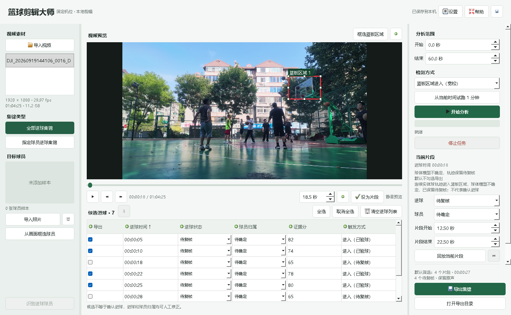
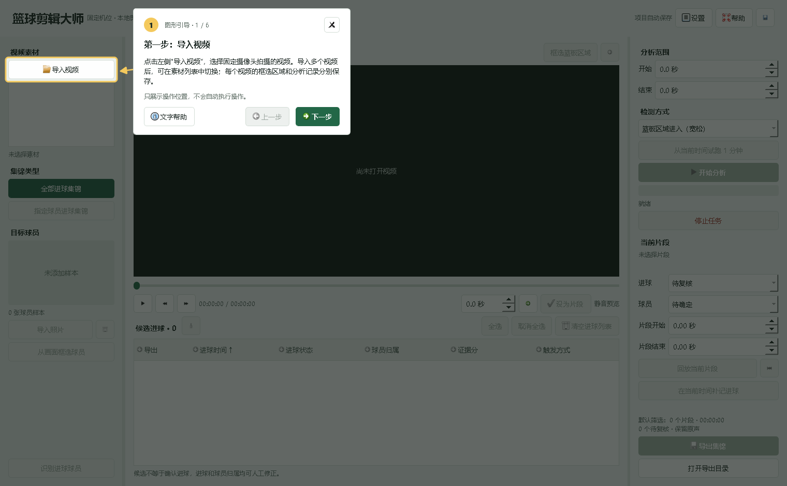
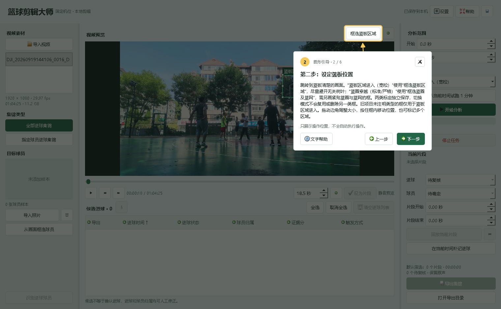
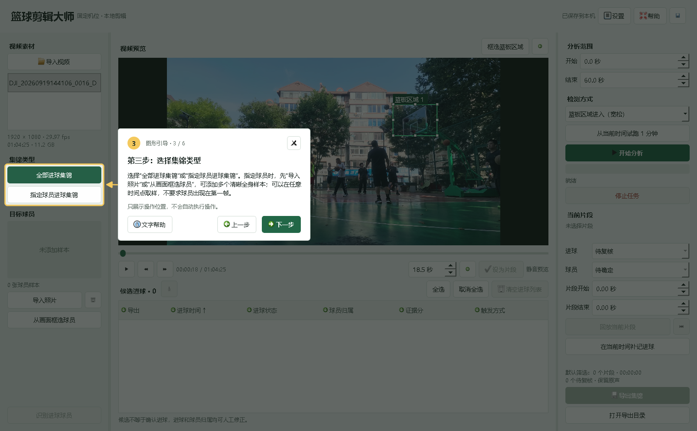
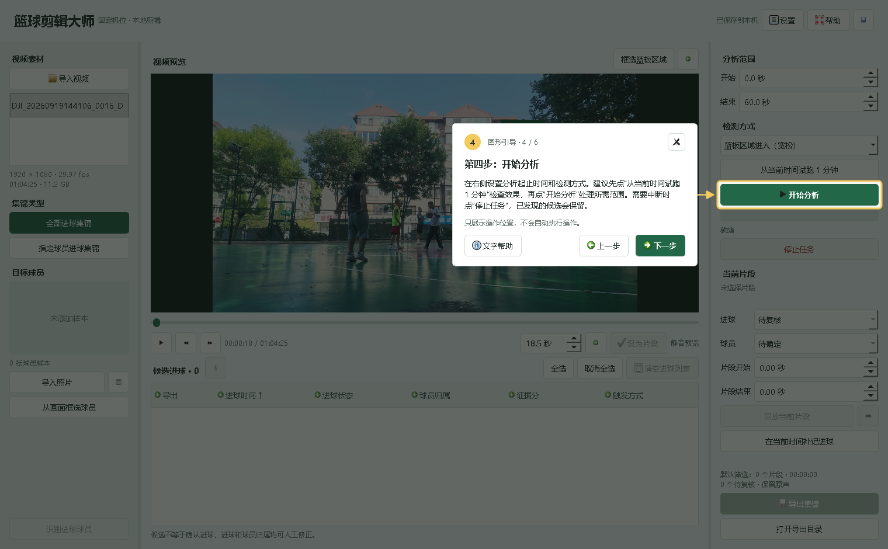
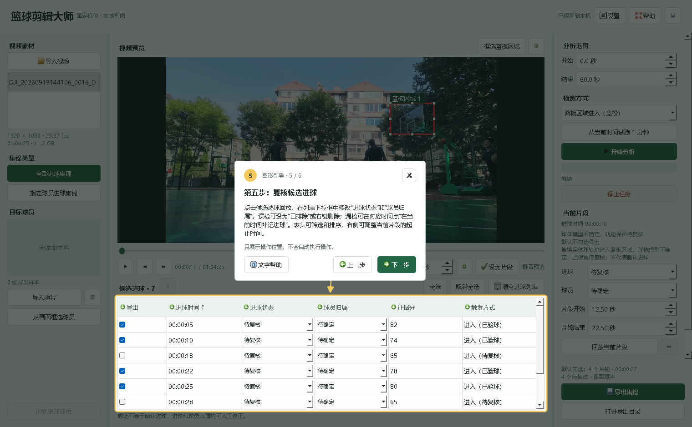
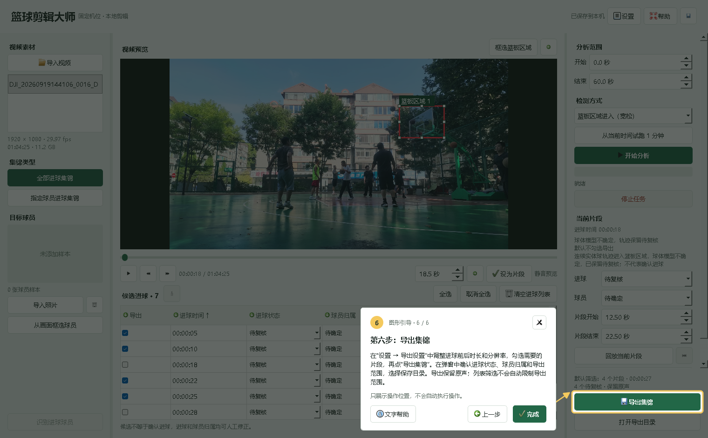
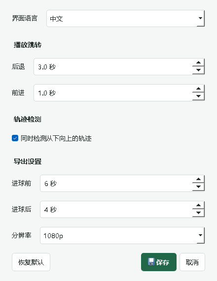
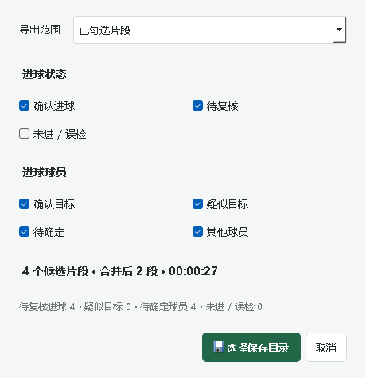

# 篮球剪辑大师：图文使用指南

[返回首页](../README.md) · [检测原理与限制](how-it-works.md) · [完整功能说明](../basketball_master/README.md)

适用于固定摄像头拍摄的篮球视频。基本流程是：**导入视频 → 框选区域 → 选择集锦类型 → 分析 → 人工复核 → 导出**。

本文截图来自当前程序的真实界面和内置“图形引导”，黄色箭头指向实际控件。使用当前本地素材 `DJI_20260919144106_0016_D.MP4` 前 60 秒的项目副本拍摄，不修改原项目；原视频和球员照片不随文档提供。截图中的候选并未被认定为有效进球，与原理文档中 167.8 秒后的历史测试不是同一视频。

## 开始前

- 按[首页的安装与启动步骤](../README.md#安装与启动)准备 Python、FFmpeg 和模型，运行 `启动篮球剪辑大师.bat`。
- 默认使用“篮板区域进入（宽松）”。它寻找值得回看的入框片段，不是自动裁判。
- 软件右上角 **帮助 → 图形引导** 可以随时重新打开下面的六步箭头提示。

## 第一步：导入视频

点击左上角 **导入视频**，选择固定机位的视频。可以导入多个文件，再从左侧素材列表切换；每个视频的标定区域、候选与人工复核结果分别保存。

左侧列表右键可移除单个视频或清空列表。这只移除素材列表条目，不删除磁盘中的原视频或保存的项目。

## 第二步：设定篮板或篮圈位置

先拖动进度条，找到篮板清楚、无遮挡的画面。在右侧选择检测方式，再点击预览上方相应的框选按钮，拖动鼠标画框。

| 检测方式 | 点击的按钮 | 应该框哪里 |
| --- | --- | --- |
| 篮板区域进入（宽松） | 框选篮板区域 | 篮板和篮筐附近需要监测的区域，尽量避开无关树叶 |
| 篮圈穿越（标准） | 框选篮圈及篮网 | 紧贴篮圈与篮网的小框，不是整块篮板 |
| 篮圈穿越（严格） | 框选篮圈及篮网 | 与标准模式共用篮圈框，要求更完整的轨迹 |

**两类框独立保存，不能互相代用。** 切换模式只显示当前类型的框，不会删除另一类框。旧项目中未注明类型的框只作为篮板区域；切换到穿越模式后，需要另外标定篮圈。

- 拖动四条边或四个角调整大小，按住框内移动位置。
- 松开鼠标自动保存，按 Esc 取消当前调整；可标记多个区域。
- 框得过大容易混入树叶、路人和其他球；框得过小可能错过球路。截图坐标只适用于示例视频，不要照搬到其他机位。
- 改框不会自动改写旧候选，需要重新分析对应范围。

## 第三步：选择集锦类型

左侧选择 **全部进球集锦** 或 **指定球员进球集锦**。

指定球员时，通过 **导入照片** 或 **从画面框选球员** 添加清晰的全身样本，尽量包含不同角度的正面、背面。可以先播放或跳到球员出现的时间，**不要求球员在第一帧**。

程序会比较上衣、短裤、腿部外观，并结合出手前的球员与球的位置判断归属。它不读球衣号码，也不做人脸识别；同款球衣和遮挡时仍需人工确认。已有候选时，可点击 **识别进球球员** 重新分析归属。

## 第四步：设定范围并开始分析

在右侧填入分析开始、结束时间，单位是秒。建议先点击 **从当前时间试跑 1 分钟**，检查框选是否合适，再点击 **开始分析**。

例如第 8 至第 11 分钟填 `480` 和 `660`，截图示例填 `0` 和 `60`。需要中断时点击 **停止任务**，已经发现的候选会保留。

区域模式下，篮球轨迹通过检查时，软件预览中的区域边框会红蓝闪烁。**闪烁只用于提示，不代表进球，也不会出现在导出的画面中。** 单独跳到未分析过的一帧没有运动信息，需要继续播放；正式分析与即时预览是两条处理流程，预览忙时可能跳过采样。

## 第五步：逐球复核与修正

点击候选列表的一行，再点 **回放当前片段**，或双击该行回放。在列表内直接使用下拉框修改“进球状态”和“球员归属”，修改自动保存。

| 项目 | 如何理解或操作 |
| --- | --- |
| 进入（已验球） | 球体模型与运动轨迹匹配，但还没有确认是否得分 |
| 进入（待复核） | 连续轨迹较强，但模型不确定；默认不勾选导出 |
| 进球状态 | 回放后改为“确认进球”，误检改为“已排除”（右侧称“未进 / 误检”） |
| 球员归属 | 确认目标、疑似目标、待确定、其他球员；人工指定后不会被自动识别覆盖 |
| 证据分 | 规则给出的证据强弱，不是进球概率或准确率 |
| 导出勾选 | 单独决定该条是否进入“已勾选片段”的导出范围，不等于确认进球 |

更多操作：

- 点击表头的下拉图标，可按状态、归属、时间、证据分等筛选和排序。
- 右键候选可删除该条，或将其进球时间设为分析范围的起始/终止时间。
- 漏检时，跳到相应时间，点击 **在当前时间补记进球**。
- 右侧可修改单个片段起止时间；选中候选后，播放栏的 **设为片段** 会用时间输入框的值作为起点，并设定其后 10 秒为终点，接近片尾时自动截断。
- **取消全选** 只取消可见条目的导出勾选；**清空进球列表** 会在确认后删除当前视频全部候选，包括被筛选隐藏的记录。二者不要混淆。

## 第六步：设置并导出集锦

先复核并勾选需要的候选，点击右下角 **导出集锦**。

### 全局设置

右上角 **设置** 统一管理语言、播放跳转、向上穿越检测及导出参数。默认后退 3 秒、前进 1 秒，进球前保留 6 秒、进球后保留 4 秒；可选 1080p、720p 或原始分辨率。

设置对所有视频生效；已手动指定的单个片段起止时间保留。空格播放/暂停，左右方向键分别按设置值后退/前进。编辑输入框或下拉框时，键盘优先操作当前控件。

### 导出筛选

点击导出后，会弹出状态筛选窗口：

上面两张导出示例图保留了这段素材中 4 条已勾选候选及其“待复核”状态，**不表示这些球已经确认进球**。正式制作得分集锦时，先人工确认，再只勾选需要的进球状态。

1. 选择 **已勾选片段** 或 **全部候选片段**。
2. 选择进球状态。默认包含“确认进球”和“待复核”，不包含“未进 / 误检”；只要已确认得分时，应取消“待复核”。
3. 选择球员归属。指定球员模式默认选择“确认目标 / 疑似目标”，只要人工确认的目标球员时，应取消“疑似目标”。
4. 检查匹配数量、合并后时长和待复核数量，再点击 **选择保存目录** 开始导出。

**列表筛选只影响显示，不会自动限制导出范围。** 要只导出筛选结果：先清除列表筛选并取消全选，再设置筛选、全选可见条目，最后以“已勾选片段”导出。

导出目录包含合并 MP4、`clips/` 分段视频、`events.json` 和 `events.csv`。重叠片段会合并，保留原视频音轨；软件预览是静音的，导出时不会把原本无声的视频变出声音。

## 常见问题

| 情况 | 检查方法 |
| --- | --- |
| 第一帧没有目标球员 | 播放或跳到球员清楚的画面，再框选样本 |
| 切换模式后看不到框 | 篮板区域和篮圈标定独立；在当前模式下重新画对应类型的框 |
| 球进入篮板区域却没有穿越候选 | 入框不等于穿越；检查模式，并区分“区域框”和“篮圈框” |
| 树叶或反光仍误报 | 缩小到必要区域，回放判断，设为“已排除”；算法不能保证完全消除干扰 |
| 列表有候选，导出数量为 0 | 检查导出勾选、状态与球员筛选；轨迹待复核候选默认未勾选 |
| 提示缺少篮球复核模型 | 运行 `setup.bat` 准备模型；分析时不会自动下载模型 |
| 重扫后旧误检还在 | 重扫保护人工结果，不自动清空历史；手动排除或删除旧误检 |

继续阅读：[检测原理、抗干扰措施与测试记录](how-it-works.md)。
